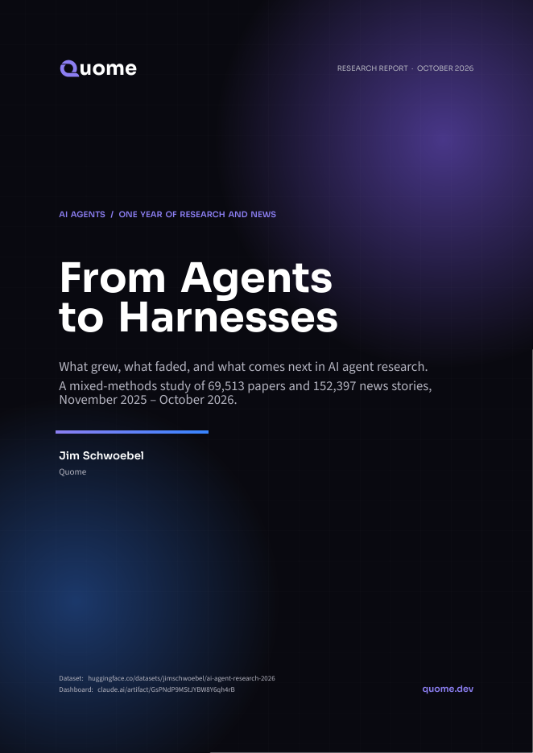
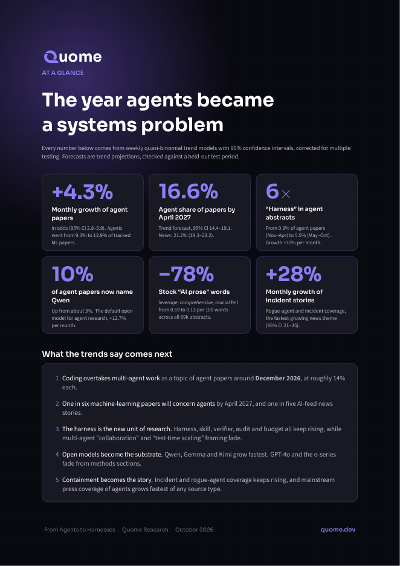
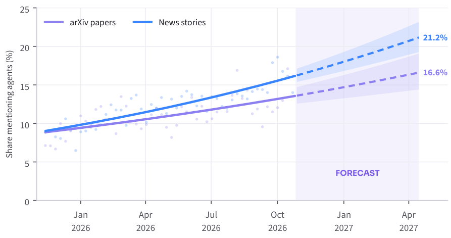
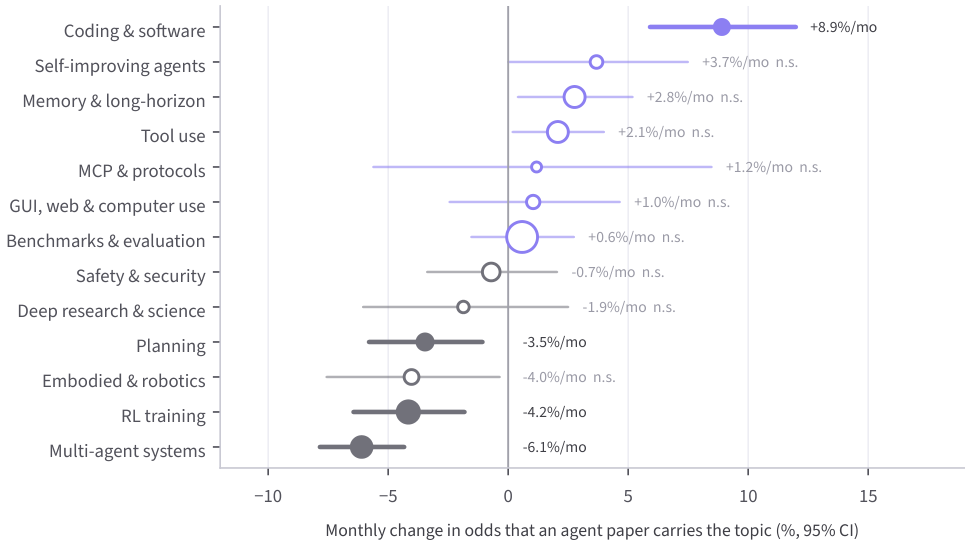
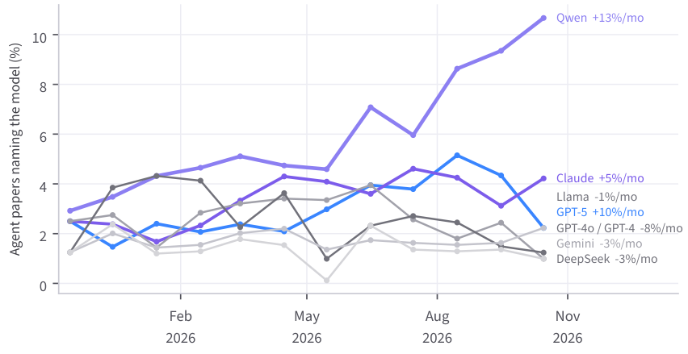
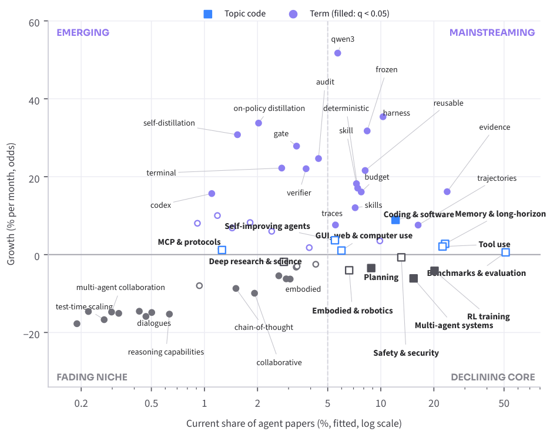
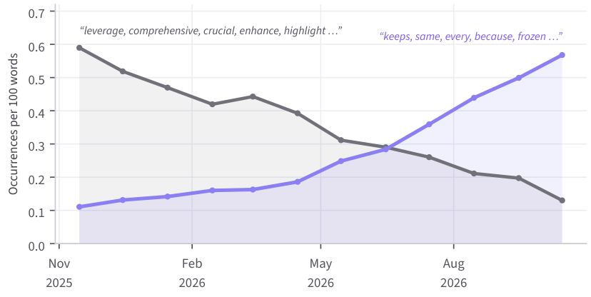

<p align="center">
  
  
</p>

# From Agents to Harnesses

**What grew, what faded, and what comes next in AI agent research.** This is a mixed-methods study of 69,513 arXiv papers and 152,397 news stories from November 2025 to October 2026, by Jim Schwoebel at [Quome](https://quome.dev).

- 📄 **Paper:** [`agent_research_2026.pdf`](agent_research_2026.pdf)
- 🤗 **Dataset:** [huggingface.co/datasets/jimschwoebel/ai-agent-research-2026](https://huggingface.co/datasets/jimschwoebel/ai-agent-research-2026)
- 📊 **Interactive dashboard:** [claude.ai/artifact/GsPNdP9MStJYBW8Y6qh4rB](https://claude.ai/artifact/GsPNdP9MStJYBW8Y6qh4rB)

## Key findings

| Finding | Number |
|---|---|
| Monthly growth in the odds that a paper concerns agents | +4.3% (95% CI 2.8–5.9) |
| Agent share of tracked ML papers, first quarter to last | 9.3% → 12.9% |
| Forecast agent share of papers, April 2027 | 16.6% (14.4–19.1) |
| Forecast agent share of AI news, April 2027 | 21.2% (19.3–23.2) |
| "Harness" in agent paper abstracts, Nov–Apr to May–Oct | 0.9% → 5.5% |
| Agent papers naming Qwen | about 3% → about 10% |
| Stock "AI prose" words per 100 words, all abstracts | 0.59 → 0.13 (−78%) |
| Monthly growth of incident and rogue-agent news | +27.7% (21.1–34.7) |

- **Coding is replacing multi-agent work.** Coding agents grew fastest, while multi-agent systems, RL training and planning declined. The two trends are projected to cross around December 2026.
- **The harness became the unit of research.** *Harness, skill, verifier, audit, budget* and *frozen* rose sharply. *Multi-agent collaboration, test-time scaling* and *chain-of-thought* faded.
- **Open models became the substrate.** Qwen, Gemma and Kimi grew fastest. GPT-4o and the o-series faded.
- **Abstracts are written differently.** Across all 69,000 abstracts, stock LLM-era words fell 78% and plain words rose fivefold. The two lines crossed in mid-2026.
- **Agents went mainstream, and so did their failures.** Agent coverage grew fastest in general and business press, and incident stories were the fastest-growing news theme.

<p align="center"></p>

<p align="center">
  
  
</p>

<p align="center">
  
  
</p>

## Methods in brief

- **Corpus.** Data come from the agents-blog aggregator's Postgres database, covering the arXiv cs.LG, cs.CV, cs.CL and stat.ML feeds plus 230 news, blog, podcast and community feeds.
- **Agent identification.** Items are flagged by keyword, with non-AI uses such as ICE or FBI agents filtered out of the news. A hand-labelled sample of 120 items checks precision. 85% of flagged papers were really about agents, and no flagged news story was a non-AI false positive.
- **Trend tests.** Each indicator gets a weekly quasi-binomial logistic trend, with Pearson dispersion and Benjamini–Hochberg false-discovery control. Kendall's tau serves as a non-parametric check.
- **Forecasts.** The fitted trends are projected to January and April 2027. They were backtested on July–October 2026 against a naive forecast. Only significant trends are forecast.
- **Qualitative analysis.** A reflexive thematic analysis of 72 abstracts and about 190 headlines explains the trends.

The analysis was done with an AI assistant (Claude, Anthropic) working under the author's direction. The paper discloses this.

## Repository layout

| Path | Contents |
|---|---|
| `agent_research_2026.pdf` / `.tex` | The paper and its LaTeX source |
| `figures/` | The nine figures, as PDF |
| `stats/` | Trend fits, q-values, projections and backtests (`trends.json`), all 3,289 term tests (`term_trends.csv`), and the writing-style index (`style.json`) |
| `data/` | Monthly aggregates used by the dashboard |
| `scripts/` | Everything used to export, label, test, forecast and plot |
| `tables/` | Generated LaTeX table rows |
| `fonts/`, `brand/` | Brand fonts (SIL OFL) and the Quome mark |
| `docs/` | PNG previews for this README |

## Reproduce

The labelled corpus is on Hugging Face. To rerun from a fresh database export, use the steps below. The export is a CSV of the `articles` table with the columns url, title, description, feed_name, feed_type and published_at.

```bash
pip install pandas numpy statsmodels scipy matplotlib adjustText pyarrow
python scripts/trends.py full.csv stats/                         # trend tests, forecasts, backtest
python scripts/style_terms.py full.csv stats/term_trends.csv stats/
python scripts/figs_brand.py full.csv stats/ fonts/ figures/      # figures
tectonic agent_research_2026.tex                                 # build the PDF
```

## Cite

```bibtex
@misc{schwoebel2026agents,
  title  = {From Agents to Harnesses: What Grew, What Faded, and What Comes Next in AI Agent Research},
  author = {Schwoebel, Jim},
  year   = {2026},
  publisher = {Quome},
  note   = {Data: https://huggingface.co/datasets/jimschwoebel/ai-agent-research-2026}
}
```

## License

The paper text, figures, statistics and code are under [CC BY 4.0](https://creativecommons.org/licenses/by/4.0/). The fonts are under the SIL Open Font License, and their license texts are in `fonts/`. The Quome logo in `brand/` is a trademark of Quome and is not covered by these licenses. See [LICENSE.md](LICENSE.md).
